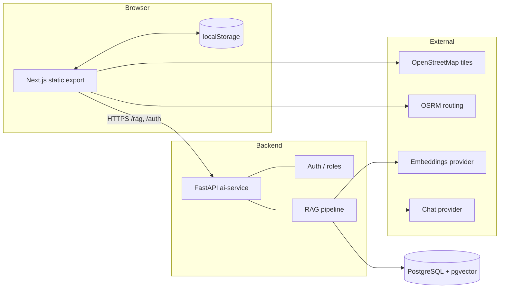
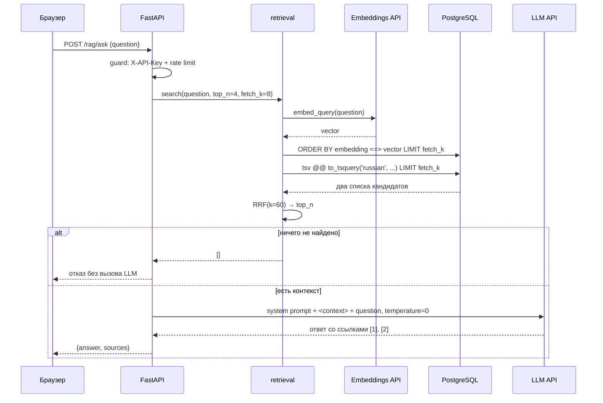
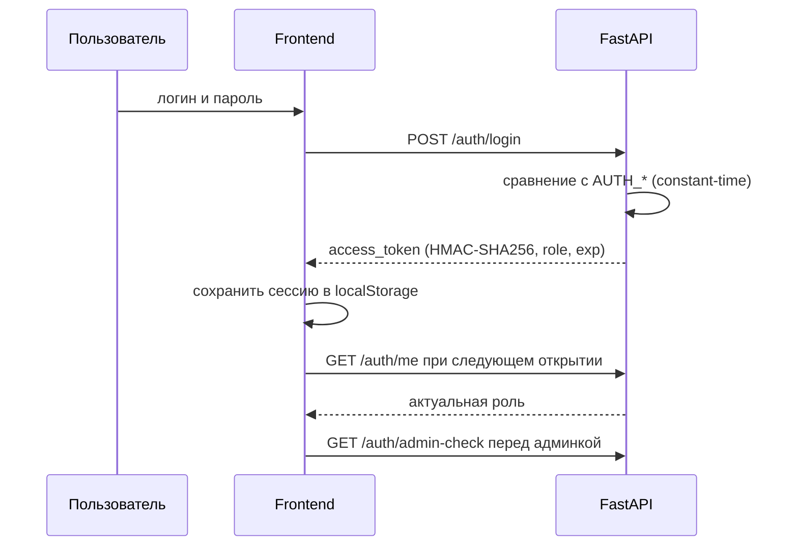

# Архитектура проекта

Документ фиксирует границы компонентов, потоки данных и осознанные компромиссы. Обзор продукта и инструкции по запуску — в корневом [`README.md`](../README.md).

---

## 1. Контекст системы



Система разделена на два независимо деплоящихся приложения:

| Компонент | Ответственность | Не знает о |
|---|---|---|
| `frontend` | отображение, локальное демо-состояние, UX-фолбэки | схеме БД, ключах провайдеров |
| `ai-service` | авторизация, поиск, работа с моделями и БД | вёрстке и клиентском состоянии |
| `evals` | измерение качества поиска и ответов | UI |
| `db` | хранение корпуса и векторов | бизнес-логике |

Контракт между фронтендом и бэкендом — HTTP/JSON, описанный в `ai-service/app/main.py` и типами в `frontend/src/lib/ragApi.ts`.

---

## 2. Фронтенд

### 2.1 Маршруты

| Маршрут | Компонент | Назначение |
|---|---|---|
| `/` | `app/page.tsx` | командный центр: карта рейсов, сценарии, AI-помощник |
| `/shushary` | `WarehouseSite` | цифровой двойник склада для посетителей |
| `/shushary/admin` | `RequireAdmin` + `WarehouseAdmin` | админ-режим склада |

`app/layout.tsx` подключает шрифты, тему и `AuthGate`; все страницы рендерятся только после успешного входа.

### 2.2 Слои

```text
app/            маршруты и композиция страниц
components/     презентационные компоненты
  warehouse/    доменная UI-часть цифрового двойника
constants/      демо-данные и справочники (без побочных эффектов)
lib/            чистая логика и клиенты внешних API
types/          доменные типы
```

Правила, которых придерживается код:

- в `components/` нет прямых `fetch` к бэкенду — только через `lib/`;
- расчёты (маршруты, симуляция, форматирование) вынесены в `lib/` и не зависят от React;
- `constants/` — статические данные, их можно безопасно импортировать на сервере и клиенте;
- доменные типы склада (`WarehouseZone`, `SimulatedEmployee`, `PositionProvider`) отделены от UI-моделей.

### 2.3 Управление состоянием

- **Сессия** — `lib/auth.ts`, внешний store на `useSyncExternalStore` + `localStorage`. Роль подтверждает сервер.
- **Изменения склада** — `lib/warehouseStore.ts`, тот же паттерн; оверрайды накладываются на базовые данные в `mergeEmployees`.
- **Симуляция** — `useNow()` даёт тик времени; `simulateEmployee(employee, now)` детерминированно вычисляет позицию, зону и статус. Это позволяет восстановить состояние после перезагрузки без сервера.
- **Локальный UI** — `useState` внутри страниц; глобального state-менеджера нет намеренно.

### 2.4 Демо-фолбэки

| Что | Основной путь | Резерв |
|---|---|---|
| Ответы помощника | `POST /rag/ask` | `constants/demoKnowledge.ts` |
| Вход | `POST /auth/login` | SHA-256-хэши в `constants/demoAuth.ts` |
| Маршрут рейса | OSRM | синтетическая кривая `buildFallbackRoute` |
| Склад | данные `constants/warehouse.ts` | — (симуляция и есть демо-режим) |

Фолбэк активируется только при недоступности основного пути и всегда явно обозначен в интерфейсе. Это позволяет показывать статическую сборку без бэкенда.

---

## 3. Бэкенд

### 3.1 Модули

| Модуль | Роль |
|---|---|
| `main.py` | создание приложения, CORS, guard (API-key + rate limit), эндпойнты |
| `config.py` | типизированные настройки, `.env`, валидация провайдеров |
| `db.py` | пул psycopg3, регистрация типа `vector` |
| `auth.py` | HMAC-токены, учётные записи из env, зависимости `current_user` / `require_admin` |
| `ratelimit.py` | in-memory лимитер по IP |
| `retrieval.py` | векторный и FTS-поиск, RRF |
| `rag.py` | промпт, вызов LLM, разбор отказа |
| `embeddings.py` | батчевые эмбеддинги, определение размерности |
| `llm.py` | адаптер Cloud.ru / GigaChat, tool calls |
| `cloud_client.py`, `gigachat_client.py` | ленивые клиенты SDK |
| `chunking.py` | нарезка Markdown на чанки |
| `ingest.py` | идемпотентная загрузка корпуса |
| `setup_db.py` | DDL, HNSW/GIN-индексы |
| `errors.py` | перевод технических ошибок в понятные сообщения |

Импорты тяжёлых зависимостей (`numpy`, SDK провайдеров, psycopg) выполняются внутри функций. Благодаря этому `--dry-run` ингеста и unit-тесты работают без ключей и сети.

### 3.2 Поток «вопрос → ответ»



Почему гибридный поиск: вектор находит по смыслу («сколько можно ехать без остановки»), FTS — по точным словам и числам («700 км», «critical»). RRF не требует калибровки скоров разных поисков и устойчив к разной длине списков.

### 3.3 Поток авторизации



Токен — не JWT, а компактный подписанный payload `base64(json).base64(hmac)`. Этого достаточно для демо: нет внешних зависимостей, роль нельзя подделать без `AUTH_SECRET`. Для продакшена рекомендуется перейти на HttpOnly-cookie + CSRF.

### 3.4 Защита

- `APP_API_KEY` — необязательный общий ключ; сравнение через `hmac.compare_digest`.
- Rate limit: 30 запросов/мин на IP для RAG и 10 попыток/мин для логина.
- Pydantic ограничивает длину вопроса (3–1000 символов) и параметры поиска.
- SQL-запросы параметризованы; имя таблицы и размерность вектора проверяются перед подстановкой в DDL.
- Внешние ошибки логируются полностью, пользователю отдаётся безопасное сообщение.

---

## 4. Данные

### 4.1 Корпус и чанки

- Источник истины — Markdown-файлы `ai-service/docs-corpus/*.md`.
- `chunking.py` извлекает документ и раздел из заголовков, режет по размеру, считает `content_hash`.
- `content_hash UNIQUE` + `ON CONFLICT DO NOTHING` делают ингест идемпотентным; устаревшие чанки удаляются по разнице хэшей.
- Вектор и `tsvector` хранятся в одной строке: это упрощает гибридный поиск и не требует второй таблицы.

### 4.2 Размерность вектора

`EMBEDDING_DIM=0` означает «определить автоматически». `setup_db` делает пробный запрос к модели, создаёт `vector(N)` и HNSW-индекс, если `N ≤ 2000`. При смене модели нужно выполнить `python -m app.setup_db --recreate`, затем повторный ингест.

### 4.3 Клиентское состояние

`localStorage` используется как осознанно простая замена серверному профилю в демо:

| Ключ | Владелец | Синхронизация |
|---|---|---|
| `wb-auth-v1` | `lib/auth.ts` | нет, роль сверяется с сервером |
| `shushary-warehouse-overrides-v1` | `lib/warehouseStore.ts` | нет, только текущий браузер |
| `theme` | `ThemeToggle` | нет |

---

## 5. Расширяемость

### 5.1 Реальное позиционирование склада

`types/warehouse.ts` задаёт контракт:

```ts
interface PositionProvider {
  id: 'demo' | 'ble' | 'uwb' | 'mobile';
  label: string;
  subscribe(listener: (positions: EmployeePosition[]) => void): () => void;
}
```

Чтобы подключить BLE/UWB, нужно реализовать `subscribe` поверх WebSocket/MQTT и заменить демо-провайдера в `WarehouseSite`/`WarehouseAdmin`. Компоненты карты уже работают с `SimulatedEmployee`, который отличается от `WarehouseEmployee` только вычисляемыми полями.

### 5.2 Новый провайдер LLM

1. Добавить клиент по образцу `cloud_client.py`.
2. Расширить `LLM_PROVIDER` и ветку в `llm.py`.
3. Привести ответ к `LLMResponse` (`text`, `tool_call`, `message`, `finish_reason`).

Остальной RAG-код не меняется.

### 5.3 Новый корпус

Добавить `.md` в `docs-corpus/`, прогнать `python -m app.ingest`. Если меняется набор разделов, обновить `evals/dataset.json` — тест `test_evals.py` проверит, что ожидаемые документы и разделы существуют.

### 5.4 Серверное хранение сотрудников

Сейчас оверрайды живут в браузере. Для многопользовательского режима нужны:

1. таблица `warehouse_employees` и CRUD-эндпойнты под `require_admin`;
2. клиент в `lib/warehouseApi.ts` по образцу `ragApi.ts`;
3. миграция `localStorage` → API при первом входе.

---

## 6. Известный технический долг

- Нет серверного хранения сотрудников и истории перемещений.
- Rate limit в памяти процесса — не масштабируется горизонтально.
- Нет CI-пайплайна: сборка и тесты запускаются вручную.
- Статический экспорт не позволяет использовать Next.js API routes; прокси `/backend` настраивается отдельно для dev, nginx и Vercel.
- Корпус и eval-набор небольшие (9 документов, 50 вопросов): метрики чувствительны к добавлению новых формулировок.
